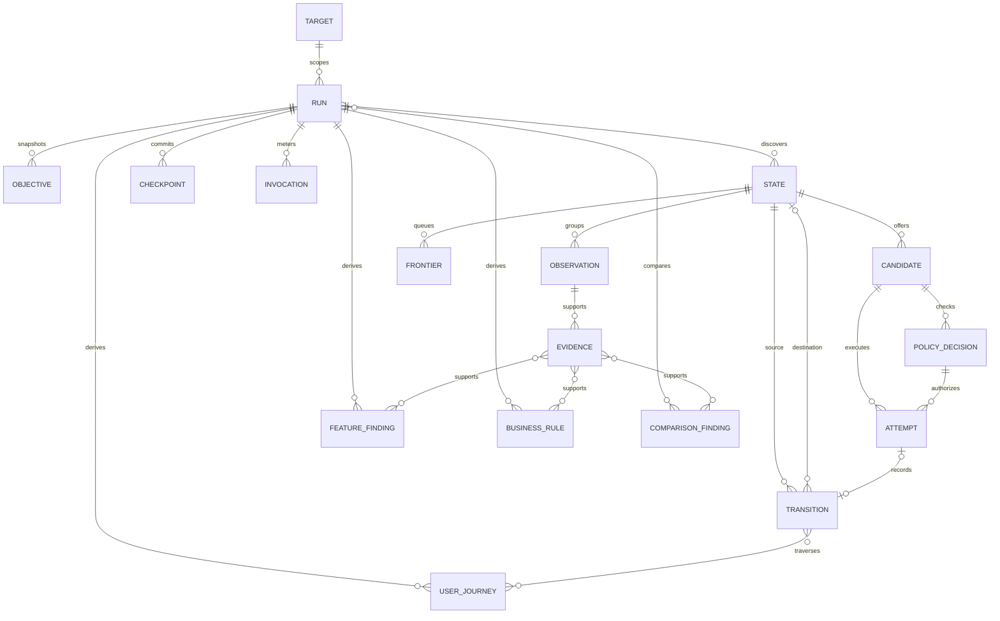

# Logical data relationships

Design baseline; no SQLite schema is implemented. JSON reference lists may be normalized to join tables. The [entity registry](ENTITY_REGISTRY.md) defines field contracts and milestone boundaries.

