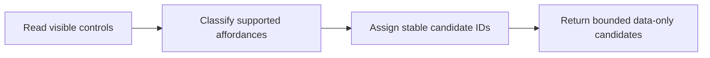

# Action discovery

**Design, M1.** Feature: [F-004](../features/F-004-action-discovery.md).

Ambiguous controls are omitted or recorded as unsupported; never use generated code.

**Planned implementation:** `src/game_explorer/actions/discover.py`. **Planned verification:** `tests/test_domain.py`; see the [test map](../testing/TEST_MAP.md) for current versus future checks.
