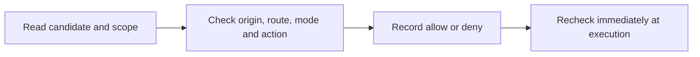

# Action validation

**Design, M1.** Feature: [F-005](../features/F-005-safety-policy-engine.md).

A stale candidate, sensitive action or unexpected network request stops execution.

**Planned implementation:** `src/game_explorer/policies/scope.py`. **Planned verification:** `tests/test_domain.py`; see the [test map](../testing/TEST_MAP.md) for current versus future checks.
