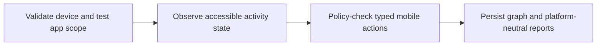

# Android exploration

**Design, M7.** Feature: [F-017](../features/F-017-android-driver.md).

On unexpected device/app context, stop rather than interacting.

**Planned implementation:** `src/game_explorer/drivers/android.py`. **Planned verification:** `tests/test_android.py`; see the [test map](../testing/TEST_MAP.md) for current versus future checks.
