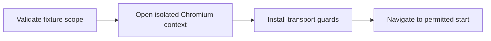

# Browser initialization

**Design, M1.** Feature: [F-001](../features/F-001-browser-automation-driver.md).

Close the context on initialization failure. No shared user profile.

**Planned implementation:** `src/game_explorer/drivers/playwright.py`. **Planned verification:** `tests/test_browser.py`; see the [test map](../testing/TEST_MAP.md) for current versus future checks.
