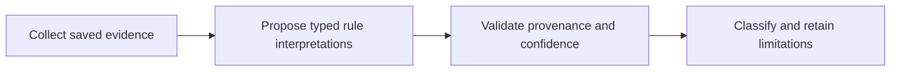

# Business rule extraction

**Design, M4.** Feature: [F-013](../features/F-013-business-rule-extraction.md).

Stated claims are advertised, not confirmed behavior; preserve contradictions.

**Planned implementation:** `src/game_explorer/analysis/rules.py`. **Planned verification:** `tests/test_analysis.py`; see the [test map](../testing/TEST_MAP.md) for current versus future checks.
