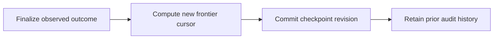

# Checkpoint creation

**Design, M3.** Feature: [F-011](../features/F-011-resumable-exploration.md).

An unfinished attempt remains uncertain until reconciled.

**Planned implementation:** `src/game_explorer/exploration/checkpoints.py`. **Planned verification:** `tests/test_recovery.py`; see the [test map](../testing/TEST_MAP.md) for current versus future checks.
