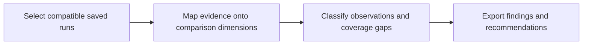

# Competitor comparison

**Design, M6.** Feature: [F-015](../features/F-015-competitor-comparison.md).

No live requests or product changes; not observed is not absent.

**Planned implementation:** `src/game_explorer/comparison/`. **Planned verification:** `tests/test_comparison.py`; see the [test map](../testing/TEST_MAP.md) for current versus future checks.
