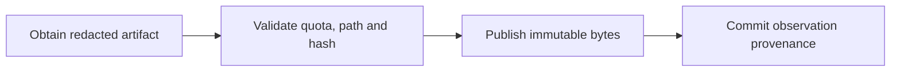

# Evidence persistence

**Design, M1.** Feature: [F-009](../features/F-009-evidence-management.md).

Do not create a dangling reference if bytes cannot be published.

**Planned implementation:** `src/game_explorer/evidence/files.py`. **Planned verification:** `tests/test_store.py`; see the [test map](../testing/TEST_MAP.md) for current versus future checks.
