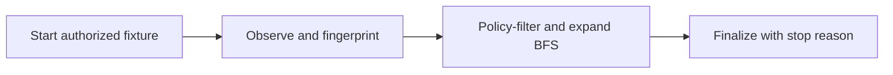

# Exploration lifecycle

**Design, M1.** Feature: [F-007](../features/F-007-exploration-planner.md).

If a budget ends first, preserve incomplete coverage and remaining work.

**Planned implementation:** `src/game_explorer/exploration/engine.py`. **Planned verification:** `tests/test_browser.py`; see the [test map](../testing/TEST_MAP.md) for current versus future checks.
