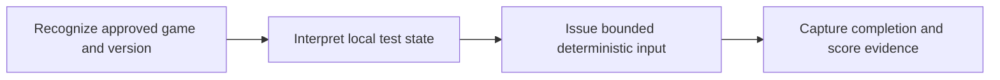

# Gameplay adapter execution

**Design, M8.** Feature: [F-018](../features/F-018-gameplay-adapters.md).

Stop on timeout or scope mismatch; prohibit external ranked play.

**Planned implementation:** `src/game_explorer/game_adapters/`. **Planned verification:** `tests/test_game_adapters.py`; see the [test map](../testing/TEST_MAP.md) for current versus future checks.
