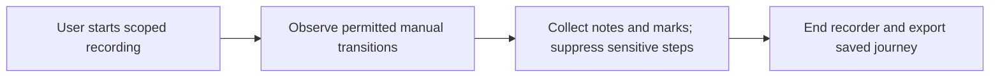

# Human guided recording

**Design, M3.** Feature: [F-021](../features/F-021-human-guided-recording.md).

Manual observations are not automatically executable replay steps.

**Planned implementation:** `src/game_explorer/recording/session.py`. **Planned verification:** `tests/test_recording.py`; see the [test map](../testing/TEST_MAP.md) for current versus future checks.
