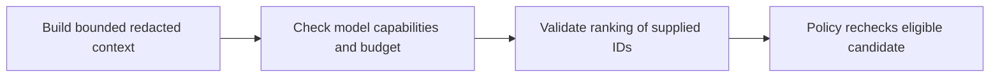

# Llm action selection

**Design, M2.** Feature: [F-010](../features/F-010-omnirouter-integration.md).

Provider failure or invalid output falls back to deterministic ordering.

**Planned implementation:** `src/game_explorer/llm/`. **Planned verification:** `tests/test_llm.py`; see the [test map](../testing/TEST_MAP.md) for current versus future checks.
