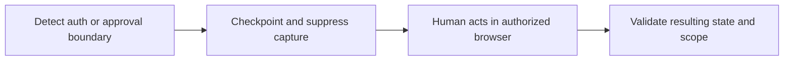

# Manual authentication

**Design, M3.** Feature: [F-012](../features/F-012-human-intervention.md).

Never ask for passwords or OTPs in tools, reports or model input.

**Planned implementation:** `src/game_explorer/recording/intervention.py`. **Planned verification:** `tests/test_intervention.py`; see the [test map](../testing/TEST_MAP.md) for current versus future checks.
