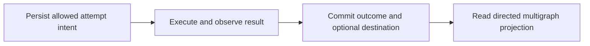

# Navigation graph updates

**Design, M1.** Feature: [F-006](../features/F-006-navigation-graph.md).

Failures retain the attempt without a fabricated destination.

**Planned implementation:** `src/game_explorer/storage/store.py`. **Planned verification:** `tests/test_store.py`; see the [test map](../testing/TEST_MAP.md) for current versus future checks.
