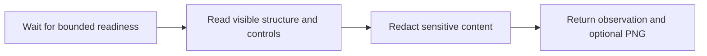

# Observation collection

**Design, M1.** Feature: [F-002](../features/F-002-observation-engine.md).

Unavailable screenshots carry a reason; do not substitute raw bytes.

**Planned implementation:** `src/game_explorer/observation/snapshot.py`. **Planned verification:** `tests/test_browser.py`; see the [test map](../testing/TEST_MAP.md) for current versus future checks.
