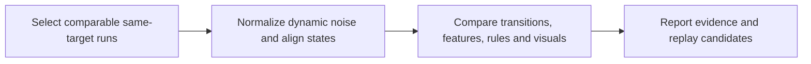

# Regression detection

**Design, M9.** Feature: [F-016](../features/F-016-regression-detection.md).

Report incomplete runs as such; generated tests remain review-only.

**Planned implementation:** `src/game_explorer/analysis/regression.py`. **Planned verification:** `tests/test_regression.py`; see the [test map](../testing/TEST_MAP.md) for current versus future checks.
