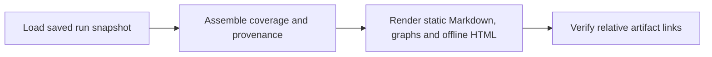

# Report generation

**Design, M1/M4.** Feature: [F-014](../features/F-014-documentation-generator.md).

Escape untrusted content and qualify every important claim.

**Planned implementation:** `src/game_explorer/reporting/offline.py`. **Planned verification:** `tests/test_browser.py`; see the [test map](../testing/TEST_MAP.md) for current versus future checks.
