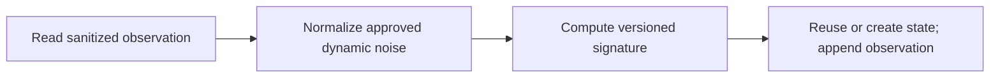

# State recognition

**Design, M1.** Feature: [F-003](../features/F-003-state-fingerprinting.md).

Permission and modal differences remain distinct.

**Planned implementation:** `src/game_explorer/state/recognize.py`. **Planned verification:** `tests/test_domain.py`; see the [test map](../testing/TEST_MAP.md) for current versus future checks.
